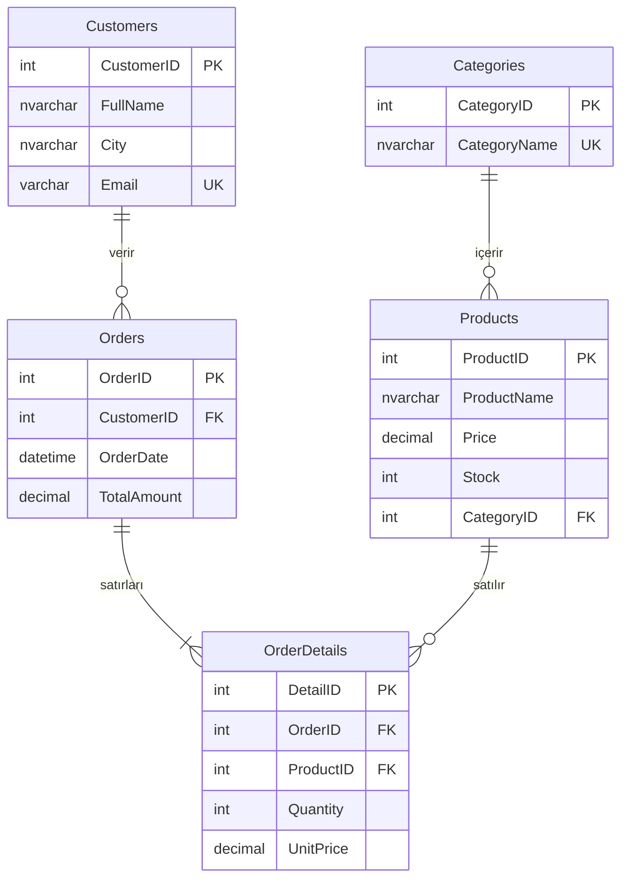
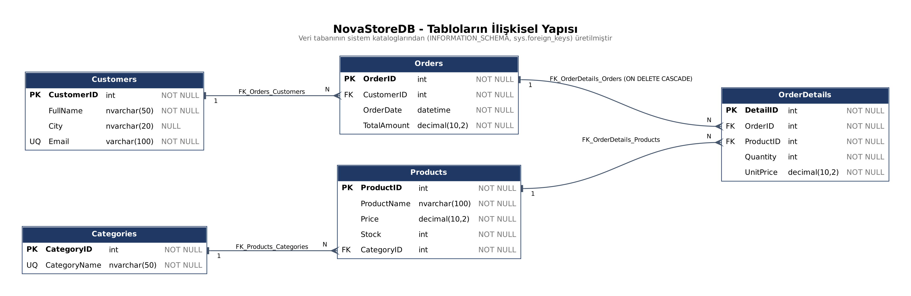
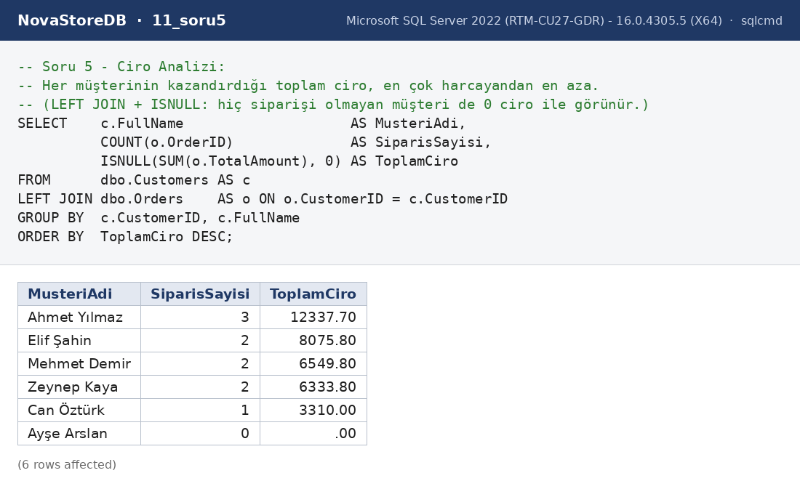
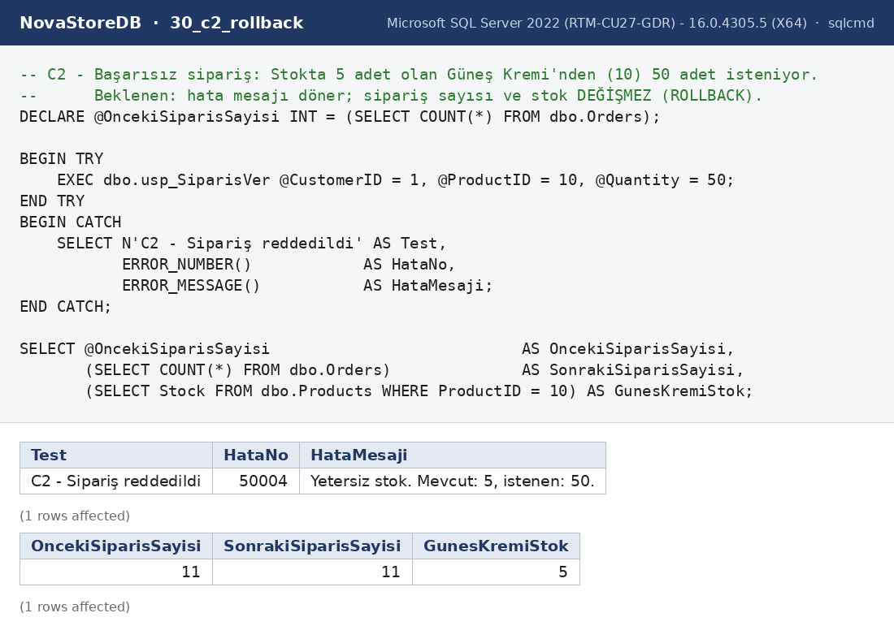

# NovaStore E-Ticaret Veri Yönetim Sistemi

SQL Server (T-SQL) ile hazırlanmış ilişkisel veri tabanı projesi. 19. Dönem Yazılım Mesleki Gelişim Programı, Veri Tabanı ve SQL eğitiminin (eğitmen: Salih Tekin) bitirme çalışmasıdır.

NovaStore adlı bir e-ticaret sitesinin ürün, müşteri ve sipariş verilerini tutan veri tabanını tasarladım; tabloları, örnek veriyi, yönetim raporlarını, view'ları ve yedekleme komutunu tek bir script içinde topladım.

## İçerik

| Dosya | Açıklama |
|---|---|
| `EfeUgur_NovaStore_Proje.sql` | Tüm adımları içeren tek script (tekrar çalıştırılabilir) |
| `EfeUgur_NovaStore_Proje.docx` | Kodlar, ekran görüntüleri ve açıklamalar |
| `EfeUgur_NovaStore_Proje.png` | Tabloların ilişki şeması (veri tabanının sistem kataloglarından üretildi) |
| `docs/er_diyagrami.png` | Tasarım aşamasında çizdiğim şema |
| `screenshots/` | Her sorgunun kodu ve SQL Server 2022'den alınan gerçek çıktısı |
| `docker_calistir.sh` | Scripti Docker içindeki SQL Server'da çalıştırır (macOS / Linux) |

## Veri modeli



Orders ile Products arasındaki çoka-çok ilişki, `OrderDetails` ara tablosu ile çözülmüştür.

## Çalıştırma

### Windows (SSMS)

Gereksinim: SQL Server 2016 veya üzeri (Express yeterli) ve SQL Server Management Studio.

1. SSMS ile sunucuya bağlanın.
2. `EfeUgur_NovaStore_Proje.sql` dosyasını açın ve F5 ile çalıştırın.
3. Script `NovaStoreDB` veri tabanını oluşturur, tabloları kurar, örnek veriyi girer, sorguları çalıştırır ve `C:\Yedek\NovaStoreDB.bak` dosyasına yedek alır.

Script her çalıştırmada nesneleri silip yeniden kurar; tekrar çalıştırmak veriyi çoğaltmaz.

### macOS / Linux (Docker)

Projeyi Docker üzerinde çalışan SQL Server 2022 ile geliştirdim ve test ettim.

```bash
cp .env.example .env      # içine güçlü bir SA şifresi yazın
bash docker_calistir.sh   # konteyneri başlatır, scripti çalıştırır
```

Çıktı `docs/calistirma_ciktisi.txt` dosyasına, yedek `yedek/NovaStoreDB.bak` dosyasına yazılır. Apple Silicon Mac'lerde Docker Desktop ayarlarında Rosetta emülasyonu açık olmalıdır.

## Örnek çıktılar







## Yönergede istenenler

- **Tasarım (DDL):** 5 tablo, birincil ve yabancı anahtarlar, NOT NULL, DEFAULT, UNIQUE kuralları
- **Veri girişi (DML):** 5 kategori, 12 ürün, 6 müşteri, 10 sipariş, 20 sipariş satırı
- **Sorgular (DQL):** stok listesi, INNER JOIN, 5 tablolu JOIN, GROUP BY + COUNT + LEFT JOIN, ciro analizi, DATEDIFF ile zaman analizi
- **View:** `vw_SiparisOzet`
- **Yedekleme:** `BACKUP DATABASE`

## Yönergeye ek olarak yaptıklarım

- **Tekrar çalıştırılabilir script ve yanlış veri tabanı koruması.** Aktif veri tabanı `NovaStoreDB` değilse script `SET NOEXEC ON` ile kendini durdurur; tablolar yanlışlıkla `master` içine kurulmaz.
- **İsimlendirilmiş kısıtlar ve CHECK kuralları.** Negatif fiyat, negatif stok, sıfır adet ve hatalı e-posta veri tabanı seviyesinde engellenir.
- **NVARCHAR.** Türkçe karakterler sunucunun dil ayarından bağımsız olarak doğru saklanır.
- **Satış anındaki birim fiyat.** `OrderDetails.UnitPrice` sayesinde ürün fiyatı değişse de eski siparişlerin tutarı bozulmaz. `Orders.TotalAmount` elle yazılmaz, satırlardan hesaplanır.
- **Index.** Yabancı anahtar sütunlarına non-clustered index.
- **SCHEMABINDING.** `vw_SiparisOzet`, kullandığı sütunların silinmesine karşı korunur; koruma script içinde test edilir.
- **Ek analiz sorguları.** Alt sorgu, HAVING, NOT EXISTS, TOP, CASE, aylık ciro.
- **Kısıt testleri.** Hatalı veriler `TRY...CATCH` içinde bilerek denenir.
- **Transaction ile sipariş prosedürü.** `usp_SiparisVer` sipariş kaydı, sipariş satırı ve stok düşme işlemini tek transaction içinde yapar; stok yetersizse `ROLLBACK` ile hiçbir değişiklik kalmaz.
- **Tutarlılık kontrolü ve yedek doğrulama.** Sipariş tutarları satırlarla karşılaştırılır; alınan yedek `RESTORE VERIFYONLY` ile doğrulanır.

## Örnek: transaction ile sipariş

```sql
-- Stokta 5 adet olan üründen 50 adet istenirse:
EXEC dbo.usp_SiparisVer @CustomerID = 1, @ProductID = 10, @Quantity = 50;
-- Msg 50004: Yetersiz stok. Mevcut: 5, istenen: 50.
-- Sipariş oluşmaz, stok değişmez.
```

## Hazırlayan

Efe Uğur
